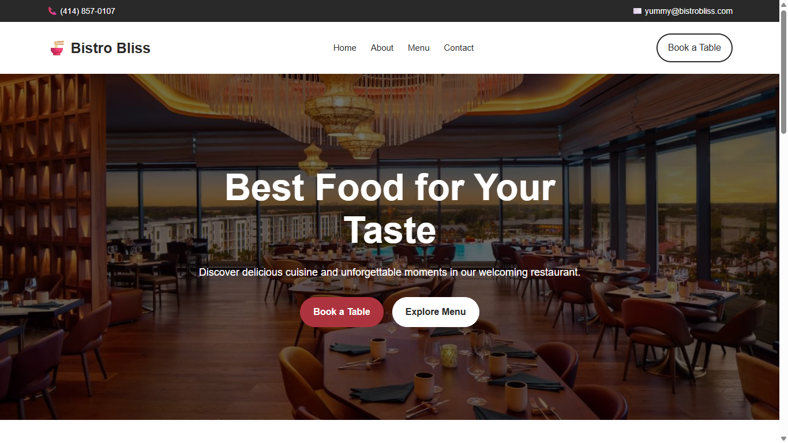
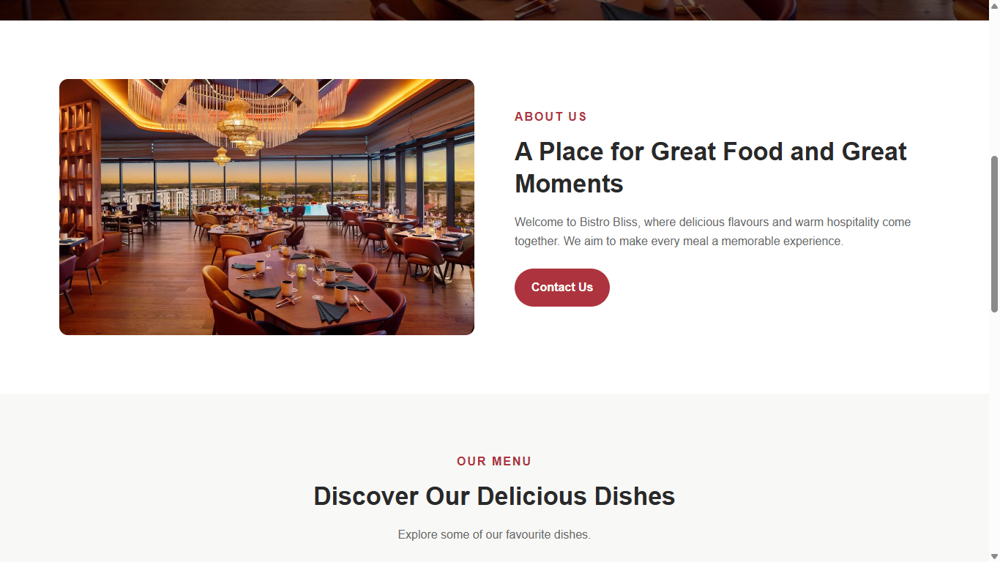
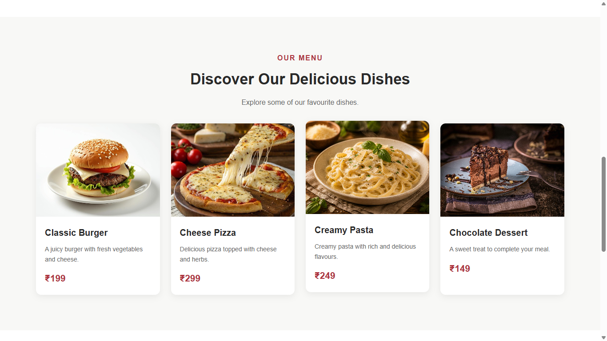
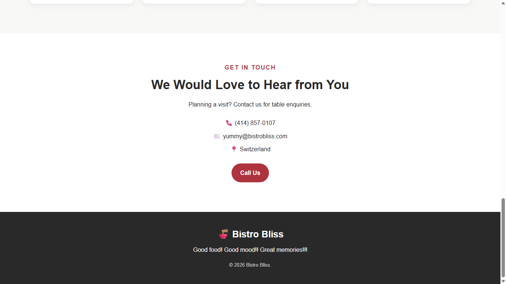

🍽️ Bistro Bliss – Restaurant Website

A modern and responsive restaurant website built using HTML5 and CSS3. Bistro Bliss showcases a restaurant's food menu, introduction, and contact information through a clean and user-friendly design.

🌐 Live Demo

Live Website: [Visit Bistro Bliss](https://kamalitherasar.github.io/Restaurant/)

📌 Project Overview

Bistro Bliss is a frontend web development project designed to provide visitors with an attractive online restaurant experience. The website allows users to explore the restaurant, browse food items, and find contact information.

This project was created to practice frontend development skills and build a portfolio project.

✨ Features

- 🏠 **Home Section** – Welcoming hero section with restaurant information.
- 👨‍🍳 **About Section** – Introduction to the restaurant.
- 🍕 **Food Menu** – Displays food items with images and descriptions.
- 📞 **Contact Section** – Provides restaurant contact information.
- 🧭 **Navigation Bar** – Easy navigation between website sections.
- 📱 **Responsive Design** – Designed to adapt to different screen sizes.
- 🎨 **Clean UI** – Simple styling with an attractive layout.

🛠️ Technologies Used

| Technology | Purpose |
|---|---|
| HTML5 | Website structure and content |
| CSS3 | Styling, layout, and responsive design |
| GitHub | Source code hosting |
| GitHub Pages | Website deployment |

📂 Project Structure

```text
Restaurant/
├── index.html
├── style.css
├── images/img.jpg
├── images/burger.jpg
├── images/pizza.jpg
├── images/pasta.jpg
├── images/dessert.jpg
├── screenshots/Home.png
├── screenshots/About.png
├── screenshots/Menu.png
├── screenshots/Contact.png
└── README.md
```


🚀 Getting Started

Follow these steps to run the project on your computer.

Prerequisites

- A web browser such as Google Chrome.
- Visual Studio Code (optional).

nstallation

1. Clone the repository:

   ```bash
   git clone https://github.com/KamalitherasaR/Restaurant.git
   ```

2. Navigate to the project folder:

   ```bash
   cd Restaurant
   ```

3. Open the folder in Visual Studio Code.

4. Open `index.html` in your browser, or use the Live Server extension in VS Code.

💻 Website Sections

1. Home
Introduces the restaurant with a welcoming heading and visual presentation.

2. About
Provides information about the restaurant and its dining experience.

3. Menu
Showcases food items with images to make the menu visually appealing.

4. Contact
Displays contact information for visitors who want to reach the restaurant.

## 📸 Website Screenshots

### 🏠 Home Page


### 👨‍🍳 About Section


### 🍕 Food Menu


### 📞 Contact Section



📱 Responsive Design

The website uses CSS styling and responsive techniques to improve usability across desktop, tablet, and mobile screens.

🔮 Future Improvements

- Add an online table reservation form.
- Create a dedicated food menu page.
- Add an interactive food ordering interface.
- Integrate a backend to manage menu items.
- Add customer reviews and ratings.
- Improve accessibility and mobile navigation.

🎯 Learning Outcomes

Through this project, I practised:

- Structuring webpages using HTML5.
- Styling layouts using CSS3.
- Organizing website sections.
- Working with images and navigation links.
- Hosting a website using GitHub Pages.
- Managing project files with GitHub.

👩‍💻 Author

**Kamalitherasa R**

- GitHub: [@KamalitherasaR](https://github.com/KamalitherasaR)
- Repository: [Bistro Bliss – Restaurant Website](https://github.com/KamalitherasaR/Restaurant)

📄 License

This project is intended for learning and portfolio purposes. Add a specific open-source license if you decide to distribute the code under particular reuse terms.

---

⭐ If you like this project, feel free to explore the repository!

*Built with HTML and CSS.*
